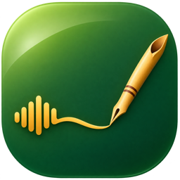

<p align="center">
  
</p>

<h1 align="center">Imla</h1>

<p align="center">
  <b>Private, on-device dictation for macOS.</b><br>
  Press a hotkey, talk, and clean text lands wherever you're typing.
</p>

<p align="center">
  <a href="https://github.com/farooqu/imla/releases/latest"></a>
  
  
</p>

*Imlāʾ* (إملاء) is Arabic for dictation: a scholar speaks, and the scribe writes down every word.

Imla lives in the menu bar. Speech recognition and cleanup both run on your Mac's GPU, so nothing you say leaves the machine.

- **Fast:** words are recognized while you speak, so the text is ready about 30 ms after you stop.
- **Clean:** fillers, stutters, and self-corrections ("Friday, actually make that Thursday") are cleaned up before the text is pasted, and "new paragraph" starts one.
- **Your words:** a vocabulary of names and jargon steers recognition toward them and fixes the usual misspellings.
- **Safe to switch away:** the text goes to the field you started in, even if focus moved while you talked. Anything Imla couldn't paste stays in Recent Dictations.
- **Self-contained:** speech is NVIDIA's Nemotron Speech Streaming English 0.6B, and cleanup is "S1-mini" by "Superwhisper". A model in [Ollama](https://ollama.com) can do the cleanup instead.

## Install

1. Download `Imla.dmg` from the [latest release](https://github.com/farooqu/imla/releases/latest), open it, and drag Imla onto the Applications folder next to it.
2. Open it. The first time, macOS refuses: it says Apple could not verify that Imla is free of malware, and offers to move it to the Trash. That's expected; see [First launch](#first-launch) below. You only do this once; updates install without asking.
3. Grant **Microphone** and **Accessibility** when asked. Accessibility is what lets Imla paste into other apps; without it, dictations go to the clipboard instead.
4. Open **Settings** from the menu bar icon and download the speech and cleanup models (about 1.2 GB together).

Imla checks for updates daily and installs them in the background; **Check for Updates…** in the menu checks now.

### First launch

Apple checks apps from outside the App Store for malware ("notarization") only when their developer pays for an Apple Developer account. Imla isn't notarized, so the first time you open it, macOS shows a warning that Apple could not verify Imla is free of malware, with **Done** and **Move to Trash** buttons. Imla is signed, but by its own certificate rather than one from Apple. To open it anyway:

1. Click **Done**, not Move to Trash.
2. Open **System Settings → Privacy & Security** and scroll down to **Security**. There's a message that Imla was blocked; click **Open Anyway** next to it and enter your password.
3. Open Imla again and click **Open Anyway** once more in the dialog that appears.

macOS remembers this, and updates don't ask again: Sparkle installs them without the quarantine flag that a browser download gets. If you'd rather use Terminal, `xattr -dr com.apple.quarantine /Applications/Imla.app` does the same before the first launch.

## Use

| Key | What it does |
|---|---|
| **⌃⌥Space** | Tap to start and tap again to finish, or hold it while you talk. Change it in Settings. |
| **Esc** | Cancel without typing anything. |
| **Menu bar icon** | Settings, the LLM toggle, and **Recent Dictations** (click one to copy it). |

Dictation starts only in a text field; apps that don't report what has focus, such as Chrome, are allowed. A small pill under the caret shows what's happening by colour: gray bars follow your voice while you speak, blue while transcribing, purple while cleaning up, green when done. Turn on **Show live transcript** in Settings to see the words scroll by instead of the bars while you speak. Apart from that, words appear in the pill only for errors.

## Resource usage

Measured on an M4 Max with both built-in models loaded:

| | Measured |
|---|---|
| Download | App 6 MB; speech model 700 MB; cleanup model 484 MB |
| Memory | About 950 MB resident, of which about 400 MB is Imla's own; the rest is the memory-mapped model files, which macOS can page out and which other apps using the same files share |
| Speed | Final transcript about 30 ms after you stop; cleanup about 50 ms for a typical dictation; an 850-word dictation about 3 s |

Turning off **Polish with LLM**, or using Ollama for cleanup, unloads S1-mini.

## How it works

1. Microphone audio is converted to 16 kHz mono and decoded by Nemotron as you speak, so recognition is nearly done when you stop.
2. Every vocabulary term biases Nemotron's decoder toward it (RNNT phrase boosting).
3. Rule-based cleanup replaces "sounds like" spellings with their terms and drops fillers (um, uh) and immediately repeated words.
4. With **Polish with LLM** on, the cleanup model removes remaining fillers, keeps only the corrected version when you backtrack ("Friday, actually make that Thursday"), turns "new paragraph" into a break, and adds punctuation. S1-mini writes numbers as digits and may add paragraph breaks to long dictations. With Ollama, the vocabulary is also sent as a glossary, and Imla warms the model when you start talking. If cleanup fails or returns something that isn't a cleanup (such as an answer to a question you dictated), the rule-cleaned text is used.
5. The text is pasted into the field that was focused when you started, even if focus moved while you talked; your clipboard is restored afterwards. If Imla can't get back to that field, it doesn't paste anywhere else: the text stays on the clipboard and in Recent Dictations.

The last 20 dictations are kept in `~/Library/Application Support/Imla/history.json`.

### Speech model

The model lives in NeMo-Speech.cpp's shared cache, not inside Imla:

```
~/Library/Caches/NeMoSpeech/models/nvidia/nemotron-speech-streaming-en-0.6b/<revision>/nemotron-speech-streaming-en-0.6b.q8_0.spm.gguf
```

`$NEMO_SPEECH_MODEL_DIR` moves it. NVIDIA's published GGUF lacks the tokenizer that phrase boosting needs, so Imla adds the original tokenizer to it; that's the `.spm.gguf`. The weights are memory-mapped, so another process using the same file shares one copy of them. Settings downloads the published model and tokenizer from Hugging Face and builds the file; the result is checked against a pinned SHA-256.

### Cleanup model

The built-in cleanup model is "S1-mini" by "Superwhisper" (0.6B, Q4_K_M), a Qwen3-0.6B fine-tune trained only to clean up dictation. It lives in the Hugging Face hub cache, where llama.cpp and the Hugging Face tools also look:

```
~/.cache/huggingface/hub/models--superwhisper--s1-mini-GGUF/snapshots/<revision>/s1-mini-q4_k_m.gguf
```

`$HF_HUB_CACHE` or `$HF_HOME` moves it. The download is checked against a pinned SHA-256. It runs with a 2K-token context, about 650 words per pass; longer dictations are cleaned a few sentences at a time, so a backtrack that spans two passes stays as spoken. A part the model can't clean, or doesn't finish, stays rule-cleaned. S1-mini follows its own trained prompt, so it doesn't see the vocabulary; terms reach it already corrected by recognition and the rules. Its license (Apache 2.0 with a naming clause) requires calling it "S1-mini" by "Superwhisper".

## Vocabulary

Add names, jargon, and abbreviations in Settings → Vocabulary, or in `~/Library/Application Support/Imla/config.json`:

```json
{ "term": "Kubernetes", "soundsLike": ["cooper netties"] }
```

- Every term biases the decoder toward it while you speak.
- **Sounds like** lists what recognition writes instead. Each is replaced with the term as a whole word, ignoring case.
- With Ollama cleanup, every term is given to the model as a glossary.

Settings → History shows what was heard next to what was typed, which is the quickest way to spot misrecognitions to add.

## Build

Needs the Xcode Command Line Tools (or Xcode), CMake, Git, and [uv](https://docs.astral.sh/uv/).

```sh
./scripts/build-app.sh   # builds the runtime if needed, then builds, signs, and installs ~/Applications/Imla.app
./scripts/test.sh        # unit tests
uv run --with pillow scripts/make-icon.py   # rebuilds Resources/AppIcon.icns from AppIcon-source.png
```

`scripts/build-runtime.sh` builds a pinned NeMo-Speech.cpp ASR library and libllama from its llama.cpp submodule, so both share one ggml, into `.runtime/lib`; the app carries them in `Contents/Frameworks`. Without Xcode, the scripts use the Command Line Tools.

`build-app.sh` signs with `$IMLA_SIGN_IDENTITY`, else an "Imla Release" or Apple Development certificate in your keychain, else ad hoc. Use a certificate: macOS forgets the Microphone and Accessibility grants of an ad hoc signed app every time it's rebuilt. Local builds never update themselves.

## Releases

To release, run `./scripts/release.sh` on an up-to-date `main`. It picks the version from the [Conventional Commits](https://www.conventionalcommits.org) since the last `v*` tag: `feat:` bumps the minor version, `fix:` and anything else the patch, and `feat!:` or a `BREAKING CHANGE:` footer the major (the minor while the version is 0.x). Only commits that change what ships in the app count (`Sources`, `Resources`, the package manifest, and the build scripts), so documentation and other housekeeping never cut a release on their own. It shows the version and the release notes it wrote from the commit subjects, and after you confirm, tags `main` with the notes as the tag message and pushes both.

The tag starts `.github/workflows/release.yml`, which builds and signs the app and publishes a GitHub release with `Imla.dmg` for new installs, and `Imla.zip` with a signed Sparkle `appcast.xml` for updates. Imla's updater reads the appcast from the latest release. Ordinary pushes don't release anything.

Releases are signed twice, without an Apple Developer account:

- a self-signed code signing certificate, which keeps macOS permissions and lets Sparkle accept the update as the same app;
- a Sparkle EdDSA key, which proves the update came from this project. Its public half is `SUPublicEDKey` in `Resources/Info.plist`.

`scripts/new-signing-keys.sh` creates both and stores them in Bitwarden. Create them once: a new certificate resets every user's permissions, and a new Sparkle key can't update apps that trust the old one. The workflow needs these repository secrets:

| Secret | Value |
|---|---|
| `IMLA_SIGNING_P12_BASE64` | The certificate and its private key, as a base64 PKCS#12 |
| `IMLA_SIGNING_P12_PASSWORD` | The PKCS#12 password |
| `SPARKLE_ED_PRIVATE_KEY` | The Sparkle private key, base64 |
